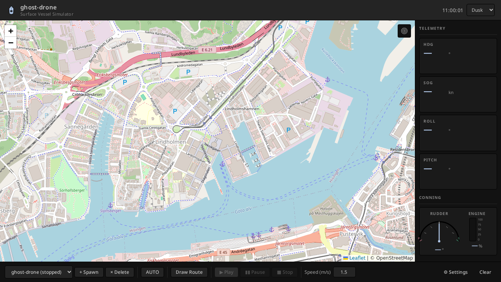
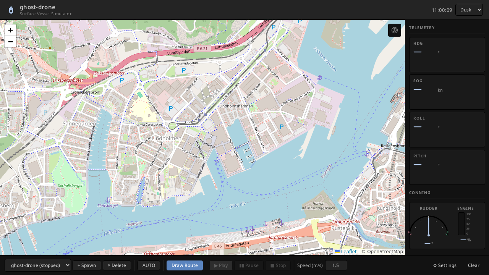
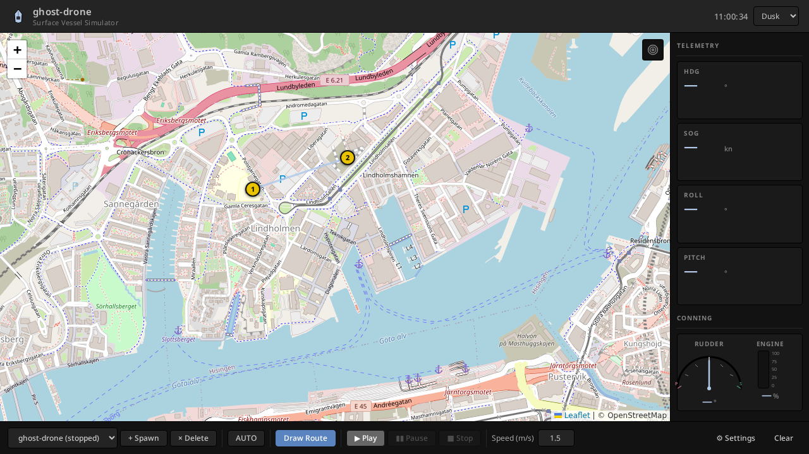
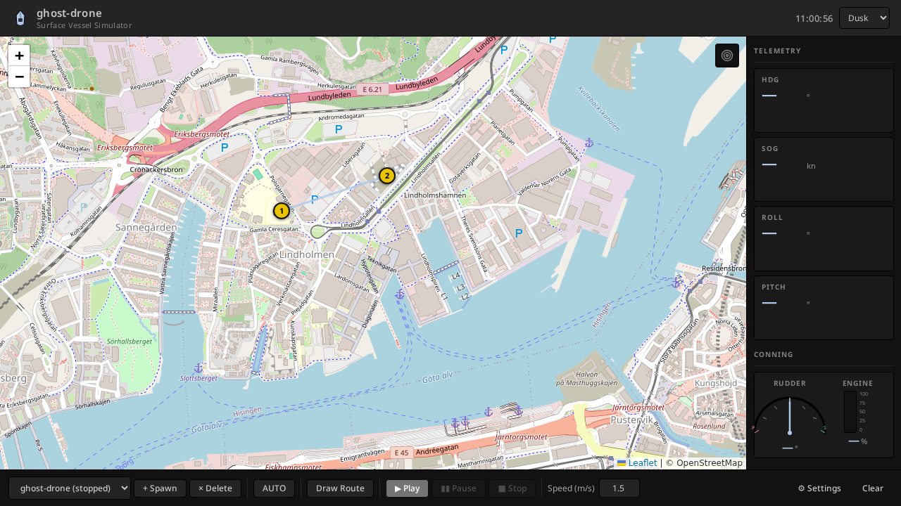
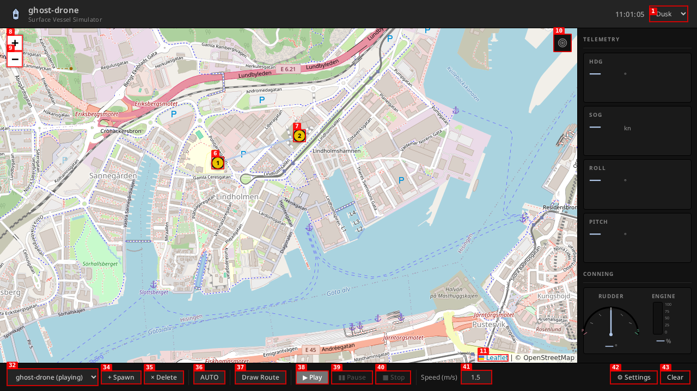
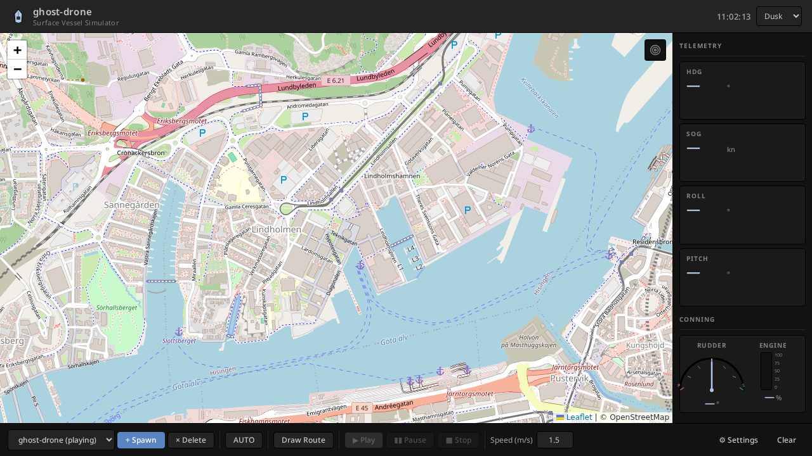
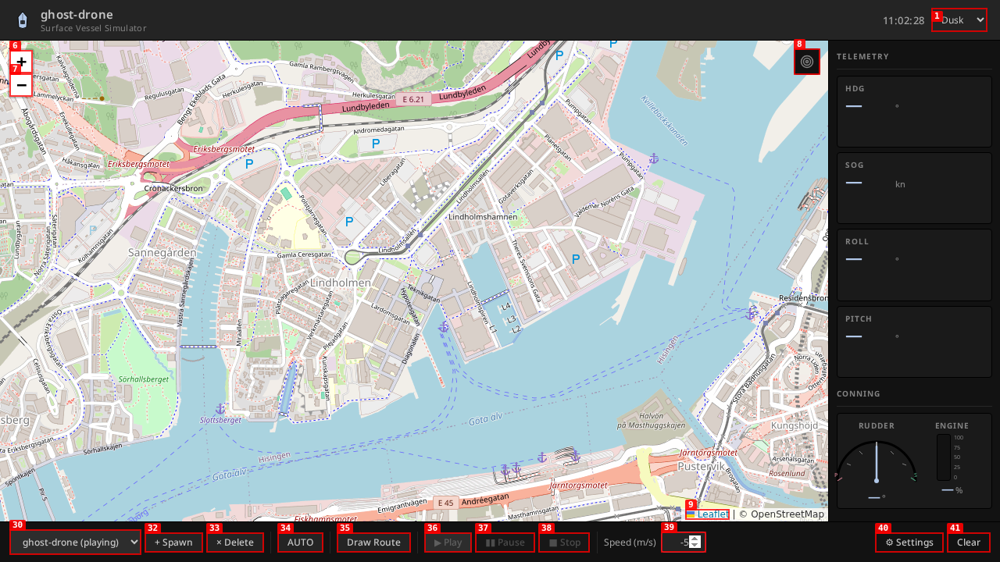
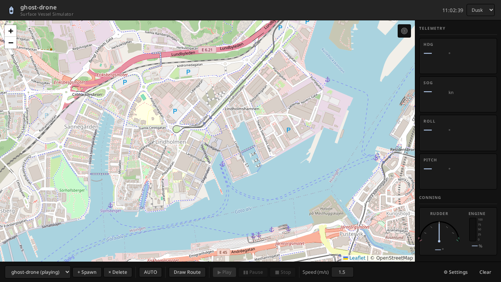
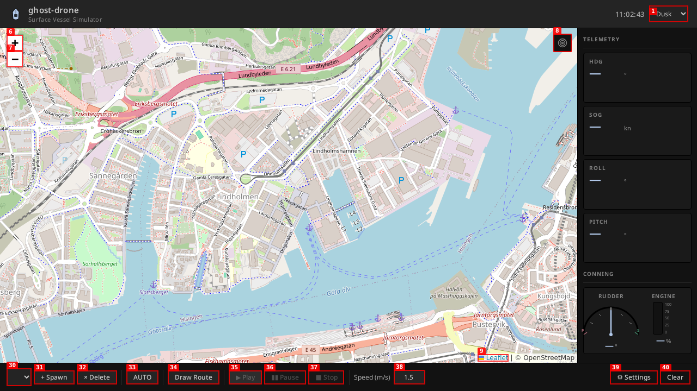

# Dogfood Report: Ghost Drone Simulator

| Field | Value |
|-------|-------|
| **Date** | 2026-03-16 |
| **App URL** | http://localhost:5173 |
| **Session** | ghost-drone |
| **Scope** | Full app |

## Summary

| Severity | Count |
|----------|-------|
| Critical | 0 |
| High | 2 |
| Medium | 3 |
| Low | 2 |
| **Total** | **7** |

## Issues

### ISSUE-001: Pause and Stop buttons remain disabled while drone is playing

| Field | Value |
|-------|-------|
| **Severity** | high |
| **Category** | functional |
| **URL** | http://localhost:5173 |
| **Repro Video** | videos/issue-001-repro.webm |

**Description**

After starting a route playback, the drone selector shows "ghost-drone (playing)" confirming the drone is in the playing state. However, the Pause and Stop buttons remain disabled, making it impossible to pause or stop the drone mid-route. The user has no way to interrupt playback once started.

**Repro Steps**

1. Load the app with a drone available. The drone shows as "ghost-drone (stopped)" in the selector.
   

2. Click "Draw Route" to enter route drawing mode.
   

3. Click on the map to add 2-3 waypoints. A route line appears connecting them.
   

4. Click "Draw Route" again to exit drawing mode, then click "Play".
   

5. **Observe:** The drone selector shows "ghost-drone (playing)" but the Pause (▮▮) and Stop (■) buttons are still grayed out/disabled. There is no way to stop the drone.
   

---

### ISSUE-002: Telemetry panel shows dashes while drone is playing

| Field | Value |
|-------|-------|
| **Severity** | high |
| **Category** | functional |
| **URL** | http://localhost:5173 |
| **Repro Video** | N/A |

**Description**

When a drone is in the "playing" state (route playback active), all telemetry values in the right sidebar remain as dashes ("—"). Expected: HDG, SOG, ROLL, PITCH, RUDDER, and ENGINE should update with live values as the drone moves along the route. The Conning gauges and Health STATUS also remain blank. The telemetry panel is non-functional during playback.

**Repro Steps**

1. Start route playback (same steps as ISSUE-001).

2. **Observe:** The telemetry panel shows: HDG — °, SOG — kn, ROLL — °, PITCH — °, RUDDER — °, ENGINE — %. Health STATUS shows "—". No values ever populate.
   

---

### ISSUE-003: No user-facing connection status indicator

| Field | Value |
|-------|-------|
| **Severity** | medium |
| **Category** | ux |
| **URL** | http://localhost:5173 |
| **Repro Video** | N/A |

**Description**

When the zenoh WebSocket bridge is unavailable, the app shows no user-visible indication of the connection failure. The console is spammed with repeated `WebSocket connection to 'ws://localhost:10001/' failed: ERR_CONNECTION_REFUSED` errors and `WebSocket has been disconnected from remote-api-plugin: 1006` warnings, but the UI looks identical to when the connection is healthy. Users have no way to know why spawning drones or other operations silently fail. Expected: A visible connection status badge or banner (e.g., "Disconnected — retrying...").

**Repro Steps**

1. **Observe:** Load the app without the zenoh bridge running. The UI looks normal — no error banner, no status indicator. Console shows dozens of WebSocket errors.
   

---

### ISSUE-004: Spawn button fails silently

| Field | Value |
|-------|-------|
| **Severity** | medium |
| **Category** | ux |
| **URL** | http://localhost:5173 |
| **Repro Video** | videos/issue-004-repro.webm |

**Description**

Clicking the "+ Spawn" button produces no visible feedback — no new drone appears in the selector, no error message, no loading indicator. The button click appears to do nothing. This was tested both with and without a working zenoh backend connection. Expected: Either a new drone should appear in the selector, or an error/feedback message should be shown.

**Repro Steps**

1. With one drone already in the selector, note the current state.
   

2. Click "+ Spawn". Wait 2 seconds. Nothing changes — still only one drone in the selector.
   

3. **Observe:** Click "+ Spawn" again. Still no change. No error, no loading spinner, no feedback of any kind.
   

---

### ISSUE-005: Speed input accepts negative and extreme values

| Field | Value |
|-------|-------|
| **Severity** | medium |
| **Category** | functional |
| **URL** | http://localhost:5173 |
| **Repro Video** | N/A |

**Description**

The "Speed (m/s)" spinbutton accepts negative values (e.g., -5) and unreasonably large values (e.g., 99999) without any validation or clamping. A negative speed is physically meaningless for a surface vessel, and extremely large speeds would produce unrealistic simulation behavior. Expected: Input should be constrained to a reasonable positive range (e.g., 0.1 to 20 m/s) with min/max attributes on the spinbutton.

**Repro Steps**

1. **Observe:** Clear the Speed field and type "-5". The value is accepted without error.
   

---

### ISSUE-006: Fault injection table header "2x" doesn't match button label "2x Rate"

| Field | Value |
|-------|-------|
| **Severity** | low |
| **Category** | content |
| **URL** | http://localhost:5173 |
| **Repro Video** | N/A |

**Description**

In the Fault Injection table, the column header reads "2x" but all the buttons in that column are labeled "2x Rate". This is a minor inconsistency — the header should match the button labels for clarity.

**Repro Steps**

1. **Observe:** Look at the Fault Injection table in the right sidebar. The last column header says "2x" while buttons say "2x Rate".
   

---

### ISSUE-007: Delete drone has no confirmation dialog

| Field | Value |
|-------|-------|
| **Severity** | low |
| **Category** | ux |
| **URL** | http://localhost:5173 |
| **Repro Video** | videos/issue-007-repro.webm |

**Description**

Clicking "× Delete" immediately removes the selected drone and its route without any confirmation prompt. This is a destructive action — if a user has drawn a complex route, an accidental click deletes everything with no undo. Expected: A confirmation dialog ("Delete drone 'ghost-drone' and its route?") before performing the deletion.

**Repro Steps**

1. A drone ("ghost-drone") is selected with a route drawn.
   

2. **Observe:** Click "× Delete". The drone is immediately removed — no confirmation dialog appears. The selector becomes empty.
   

---
